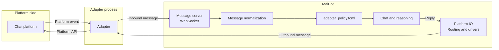

# Adapter Integration

**An adapter connects MaiBot to a chat platform.** MaiBot itself carries no platform logic and understands exactly one unified message format; the adapter does the translation.

This page helps you pick a route and get oriented on the skeleton; for the wire format see [Message Protocol Reference](./protocol.md), and for implementation see [Writing an Adapter](./build.md).

## Five Integration Routes

Ready-made routes install and go; their setup lives in [Connect Platforms](/en/manual/adapters/). The self-built route is what the rest of this section covers.

**OneBot Adapter** — an officially maintained plugin that logs in your own QQ account and supports NapCat and other OneBot v11 implementations, detecting the peer implementation on connect. Pick it for the full QQ feature set.

**Official bot (QQ Open Platform)** — an officially maintained plugin that talks to the QQ Open Platform directly with AppID + AppSecret, with no QQ client to host. Pick it when you don't want to keep a QQ account online.

**Built-in Telegram adapter** — shipped with the core (`src/plugins/built_in/telegram_adapter`); set `bot_token` in the WebUI and toggle it. Supports forum topics, stickers, voice, quotes, and forwards.

**Built-in WeChat ClawBot adapter** — shipped with the core (`src/plugins/built_in/weixin_clawbot_adapter`); goes through WeChat iLink / ClawBot, supports multi-account QR binding, and covers ClawBot private chats.

**Self-built adapter** — write one when a platform isn't covered. Two shapes, both landing in the same routing and policy layer, and they can coexist:

- **Standalone process** — deployed and upgraded on its own, so a crash leaves MaiBot untouched; any language works as long as it speaks WebSocket and that JSON. Wire format in [Message Protocol Reference](./protocol.md), implementation in [Writing an Adapter](./build.md).
- **Plugin gateway ([`@MessageGateway`](/en/develop/plugin/message-gateway))** — send and receive inside a plugin, with the plugin runtime owning its lifecycle so it starts and stops with Mai; Python only. Good for lightweight platforms, internal systems, or a plugin you already have that should also carry messages.

The first four routes ship as plugins — install them and fill in the connection details. Only the self-built route needs the protocol and code pages below.

## Who Does What



- **Adapter** — the platform protocol translator: it logs in, receives events, converts platform messages into the unified format and sends them in; when a reply in the unified format comes back, it calls the platform API to deliver it.
- **Message server** — handles only WebSocket access, authentication, and handing messages to the chat pipeline.
- **Platform IO** — outbound, it uses `platform` / `account_id` / `scope` to find which driver the message should go to, and it also deduplicates inbound messages.
- **Access policy** — `config/adapter_policy.toml` decides which groups and which users are allowed; see [Access Policy and Account Routing](./policy.md).

All an adapter has to do is turn platform events into something like this (replies use the same structure, just in the other direction):

::: code-group

```json [one inbound message ~vscode-icons:file-type-json~]
{
  "message_info": {
    "platform": "telegram",
    "message_id": "114514",
    "time": 1750000000.0,
    "group_info": { "platform": "telegram", "group_id": "-1001234567890", "group_name": "摸鱼群" },
    "user_info": { "platform": "telegram", "user_id": "10086", "user_nickname": "阿岚" },
    "additional_config": { "platform_io_account_id": "bot_1" }
  },
  "message_segment": { "type": "text", "data": "麦麦在吗" }
}
```

:::

For how to fill in every field — and which ones break the pipeline when missing — see the [Message Protocol Reference](./protocol.md).

## Choosing Between the Two WebSocket Services

Bot processes no longer listen on a message port of their own. Both protocols hang off the Host's single HTTP port, and the Bot ID in the path picks the target bot:

**Legacy message server** — enabled by default at `ws://<host>:<port>/maim/<bot_id>/ws`, authenticated with that bot's `maim_message.auth_token`. The handshake headers are `platform` + `authorization`, and a platform may have only one connection. The vast majority of existing adapters use this one.

**API server (Additional API Server)** — disabled by default; enable that bot's `maim_message.enable_api_server` and connect to `ws://<host>:<port>/maim/<bot_id>/api`, authenticated with `api_server_allowed_api_keys`. The handshake uses `x-apikey` / `x-platform` / `x-uuid`; it supports multiple connections and an API Key allowlist, wraps every message in an extra envelope (`ver` / `msg_id` / `type` / `meta` / `payload`), and provides ACKs plus resend after a reconnect.

::: warning Empty credential lists reject every connection
When `auth_token` or `api_server_allowed_api_keys` is empty, that protocol refuses all connections. Fill in the matching list before turning a protocol on.
:::

## The Library Used for Self-Built Adapters

Wrap `maim_message` to skip the WebSocket handshake, unified-format serialization, and receipt handling:

<Linkcard url="https://github.com/Mai-with-u/maim_message" title="maim_message" description="The unified message format and WebSocket communication library—required for writing an adapter" logo="/title_img/mai.png" />

Installing and configuring ready-made adapters is a usage topic, covered in [Connect Platforms](/en/manual/adapters/); everything after this point is about **writing your own**.

## What You Need Before You Start

- **Platform-side capability** — you can receive message events and call a send API. Usually this is the platform's official SDK, an OneBot implementation, or a private protocol library.
- **Python 3.10+** — the official `maim_message` library saves you from every protocol detail; in another language you implement the WebSocket and JSON structures yourself.
- **Host address, bot ID, and token** — for a local deployment this is `ws://127.0.0.1:8001/maim/<bot_id>/ws`, and the bot ID is shown in the WebUI's bot management; send whatever `auth_token` holds.
- **A platform name that doesn't collide** — for example `telegram` or `discord`. The core reserves `webui`, `internal`, `bot_console`, and `maisaka_cli`.

## Next Steps

- See what the messages look like → [Message Protocol Reference](./protocol.md)
- Provide user and group avatars → [Avatar API](/en/develop/adapters/avatar-api)
- Write a minimal working adapter → [Writing an Adapter](./build.md)
- Control who may use it and how multiple accounts are routed → [Access Policy and Account Routing](./policy.md)
- Can't connect, can't receive, can't send → [Adapter Debugging](./debugging.md)

## Verify and Troubleshoot

**Verification** — start MaiBot, then the adapter, then send a message on the platform: MaiBot's console shows an inbound log entry and a reply, which means both directions work.

- **The adapter reports a connection failure the moment it starts** — the URL is missing the bot ID, it still uses the old root path `/ws`, or the host only listens on loopback while you connect from a container or another machine. Verify `ws://<host>:<port>/maim/<bot_id>/ws`, then check the host listen address and port reachability.
- **Connected, but MaiBot doesn't react** — first check whether the platform name matches the records in the access policy, then check whether `adapter_policy.toml` allows that group / user.
- **Replies never go out** — check whether the outbound driver was taken over by a plugin gateway, or whether a private chat is missing `platform_io_target_user_id`; see [Adapter Debugging](./debugging.md) for details.
- **Repeatedly kicked offline** — two legacy connections are running under the same `platform`; stop the extra one.
