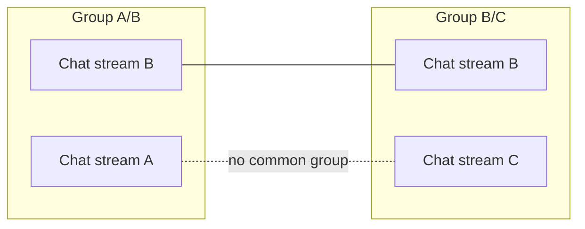

# Sharing Groups

Bundle several chat streams into one group so expressions, jargon or long-term memory inside it become visible to each other. Groups and their membership live in each Bot instance's own database, so every Bot has its own set.

## What sharing groups solve

By default each chat stream only sees what it learned itself. A sharing group gives you a controlled opening: only streams in the same group, with the matching capability enabled, can read each other, and everything outside stays isolated.

A group carries these properties, and editing them does not require stopping the Bot:

::: fields
- **Name** — required, up to 100 characters.
- **Colour** — the node colour in the relationship view; a new group picks one automatically.
- **Note** — empty by default, up to 4000 characters, for your own reference.
- **Enabled switch** — turning it off removes the group from sharing without deleting members or content.
- **Revision** — increments on each save and reveals two people editing the same group; it is not a history version and cannot roll back.
:::

Sharing groups have no manual ordering.

## Creating groups and adding members

The entry point is WebUI **通讯录 → 相通** (Contacts → Sharing). **共享组设置** (Sharing group settings) in the `⋮` menu of **麦麦设置** (Bot settings) opens the same management page, where you can also create groups and change members.

Members are either ticked explicitly or registered by rule: platform, target and chat type match chat streams created later, so you need not tick each one after it appears. Rules are what a group imported from legacy config arrives with; you can delete a rule on the page and switch to ticking fixed members.

One group can carry several capabilities at once, and one chat stream can belong to several groups.

## The three capabilities

::: fields
- **Expression** — the group shares learned expressions.
- **Jargon** — the group shares learned jargon.
- **Long-term memory** — retrieval inside the group consults other members' memory paragraphs, facts and evidence, episodes and summaries; newly produced content is still recorded under its own chat.
:::

Emoji are not part of this: they are instance-level shared resources that every chat already uses, so no sharing group is needed. Expressions cover learned ways of speaking, not emoji.

Capabilities switch per group. Turning one off only stops that group sharing that item; the rest are unaffected.

The learning and usage switches on a chat stream still apply independently: a stream with expression learning off reads no expressions from its group. Existing global-public content keeps its meaning.

## Scope rules

What the current chat can read is **itself, plus the members of every enabled group it belongs to directly, for the capability in question**.

That union does not extend along the groups other members belong to. If A and B are in one group and B and C in another, A cannot read C — A and C share no direct group.

Shared reading only widens retrieval: records are not copied and are not re-attributed to the current chat. Anything you actually retell becomes a new message in a new chat event.

## How legacy config migrates in

The legacy grouping fields and the legacy global memory switch still exist in `bot_config.toml`, but they are only used for the first import. After it, they no longer take part in runtime resolution and the WebUI no longer offers controls for them. Manage groups on the sharing page; editing the config file does not overwrite database groups.

The first config load imports once:

- Each legacy group becomes one sharing group with only its original capability enabled; groups with the same or a similar name are not merged automatically.
- The legacy global memory switch becomes one dynamic-rule group matching every chat.
- A legacy expression group with no members stays an empty group and takes part in no sharing.

The completion marker and all groups commit in one transaction; a failure rolls everything back and the import retries on the next start.

Deleting a group keeps its one-time import record, so a restart does not resurrect it.

## Verification and troubleshooting

**Verify**: the sharing page lists the group and the members it resolves to. Teach Mai an expression or mention one specific thing in a chat inside the group, then ask in another member chat — it should be available. Ask the same question from a chat outside the group, and it should not hit.

- **Another member chat sees nothing** — confirm the group has that capability on, both sides are in the same group, and neither side has its learning or usage switch off.
- **A reads B, B reads C, but A cannot read C** — this follows the scope rules; sharing does not pass along through B. Put A and C in the same group if they need to see each other.
- **Group changes have no effect** — check whether the group is disabled; disabling only stops sharing and deletes nothing, so re-enable it.
- **Revision conflict reported** — the same group was changed elsewhere; reload the page to see the current content, then save.
- **A legacy group is missing** — the import runs once, so config edits after the completion marker create nothing; build the group by hand on the page.
- **Memory still leaks outside the group** — check which sharing groups the current chat belongs to, and whether `a_memorix.filter` lets that chat stream through.
