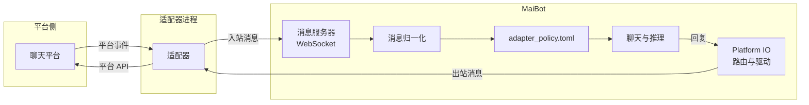

# 适配器接入

**适配器（Adapter）把 MaiBot 接进一个聊天平台。** MaiBot 本体不含任何平台逻辑，只认一套统一消息格式，剩下的活全由适配器翻译。

本页帮你选路线、认骨架；报文细节见[消息协议参考](./protocol.md)，动手实现见[编写一个适配器](./build.md)。

## 五条接入路线

按「平台已经有现成适配器」还是「自己写」分两类。现成路线装上就能用，安装步骤在[接入平台](/manual/adapters/)；自建路线从本页往下读。

**OneBot 适配器** — 官方维护的插件，登录你自己的 QQ 号，支持 NapCat 等 OneBot v11 实现，连上后自动识别对端是哪一种实现。要完整 QQ 功能就用它。

**官方机器人（QQ 开放平台）** — 官方维护的插件，用 AppID + AppSecret 直连 QQ 开放平台，不用登录任何 QQ 客户端。不需要自己挂 QQ 时选它。

**内置 Telegram 适配器** — 主程序自带（`src/plugins/built_in/telegram_adapter`），在 WebUI 填 `bot_token` 即可启停，支持论坛话题、贴纸、语音、引用与转发。

**内置微信 ClawBot 适配器** — 主程序自带（`src/plugins/built_in/weixin_clawbot_adapter`），走微信 iLink / ClawBot，支持多账号扫码绑定，适用范围是 ClawBot 私聊。

**自建适配器** — 平台没被覆盖时自己写。两种形态，最终汇入同一套路由与策略，也可以并存：

- **外部独立进程** — 单独部署单独升级，进程崩了不影响麦麦本体，可以跨语言（只要能说 WebSocket + 那套 JSON）。协议见[消息协议参考](./protocol.md)，实现见[编写一个适配器](./build.md)。
- **插件网关（[`@MessageGateway`](/develop/plugin/message-gateway)）** — 把收发写进一个插件，由插件运行时托管生命周期，跟着麦麦一起启停，只能写 Python。适合轻量平台、内部系统，或你已经有一个插件想顺便收发消息。

前四条路线都是插件形态，装完在插件设置里填连接信息；自建适配器才需要看本分区的协议与代码。

## 谁负责什么



- **适配器** — 平台协议翻译：登录、收事件、把平台消息转成统一格式发进来；收到统一格式的回复再调平台 API 发出去。
- **消息服务器** — 只负责 WebSocket 接入、认证和把消息交给聊天管线。
- **Platform IO** — 出站时按 `platform` / `account_id` / `scope` 找到该发给哪个驱动，并做入站去重。
- **访问策略** — `config/adapter_policy.toml` 决定哪些群、哪些人放行，见[访问策略与账户路由](./policy.md)。

适配器要做的，就是把平台事件拼成下面这种东西发过来（回复也是同一个结构，只是方向相反）：

::: code-group

```json [一条入站消息 ~vscode-icons:file-type-json~]
{
  "message_info": {
    "platform": "telegram",
    "message_id": "114514",
    "time": 1750000000.0,
    "group_info": { "platform": "telegram", "group_id": "-1001234567890", "group_name": "摸鱼群" },
    "user_info": { "platform": "telegram", "user_id": "10086", "user_nickname": "阿岚" },
    "additional_config": { "platform_io_account_id": "bot_1" }
  },
  "message_segment": { "type": "text", "data": "麦麦在吗" }
}
```

:::

字段逐个怎么填、哪些不填会直接崩，见[消息协议参考](./protocol.md)。

## 两套 WebSocket 服务怎么选

主程序不再监听独立的消息端口，两个协议都挂在宿主（Host）的同一个 HTTP 端口上，靠路径里的 Bot ID 区分目标 Bot：

**经典消息服务器（Legacy）** — 默认开启，连 `ws://<宿主地址>:<宿主端口>/maim/<bot_id>/ws`，凭据是该 Bot 的 `maim_message.auth_token`。握手头 `platform` + `authorization`，一个平台只能有一条连接。现有适配器绝大多数走这条。

**API 服务器（Additional API Server）** — 默认关闭，需要把该 Bot 的 `maim_message.enable_api_server` 打开，连 `ws://<宿主地址>:<宿主端口>/maim/<bot_id>/api`，凭据是 `api_server_allowed_api_keys`。握手用 `x-apikey` / `x-platform` / `x-uuid`，支持多连接与 API Key 白名单，报文外层多一个信封（`ver` / `msg_id` / `type` / `meta` / `payload`），并带 ACK 与断线重发。

::: warning 空凭据列表拒绝全部连接
`auth_token` 与 `api_server_allowed_api_keys` 为空时，该协议拒绝所有连接。要开哪个协议，先把对应的凭据列表填上。
:::

## 自建适配器用到的库

自己写适配器时套 `maim_message`，省掉 WebSocket 握手、统一格式序列化和回执处理：

<Linkcard url="https://github.com/Mai-with-u/maim_message" title="maim_message" description="统一消息格式与 WebSocket 通信库，写适配器必装" logo="/title_img/mai.png" />

现成适配器的安装与配置见[接入平台](/manual/adapters/)；本页之后的内容都是**自己写一个**。

## 接入前你要准备什么

- **平台侧能力** — 能拿到消息事件、能调发送接口。通常是平台官方 SDK、OneBot 实现或私有协议库。
- **Python 3.10+** — 用官方 `maim_message` 库能省掉全部协议细节；其他语言需要自己实现 WebSocket 与 JSON 结构。
- **宿主地址、Bot ID 与令牌** — 本机部署是 `ws://127.0.0.1:8001/maim/<bot_id>/ws`，Bot ID 在 WebUI 的 Bot 管理里能看到；`auth_token` 里配了什么就带什么。
- **一个不冲突的平台名** — 例如 `telegram`、`discord`。`webui`、`internal`、`bot_console`、`maisaka_cli` 由主程序占用。

## 接下来

- 搞清报文长什么样 → [消息协议参考](./protocol.md)
- 提供用户与群头像 → [头像接口](/develop/adapters/avatar-api)
- 动手写最小可用适配器 → [编写一个适配器](./build.md)
- 控制谁能用、多账号怎么路由 → [访问策略与账户路由](./policy.md)
- 连不上、收不到、发不出 → [适配器排错](./debugging.md)

## 验证与排错

**验收动作** — 启动 MaiBot，再启动适配器，往平台发一条消息：MaiBot 控制台出现入站日志并回复，说明收发都通了。

- **适配器启动即报连接失败** — 地址少写了 Bot ID、用的是旧根路径 `/ws`，或宿主只监听回环地址却从容器/另一台机器连。确认 `ws://<宿主>:<端口>/maim/<bot_id>/ws`，再检查宿主监听地址与端口放行。
- **连上了但 MaiBot 没反应** — 先看平台名是否与访问策略里的记录一致，再看 `adapter_policy.toml` 是否放行了该群 / 该用户。
- **回复发不出去** — 检查出站驱动是否被插件网关抢占，或私聊缺 `platform_io_target_user_id`；详见[适配器排错](./debugging.md)。
- **反复被顶下线** — 同一个 `platform` 同时跑了两条经典连接，停掉多余的那个。
