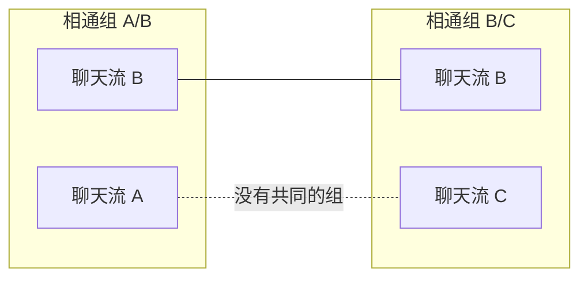

# 相通组

把几个聊天流编成一组，让组内的表达、黑话或长期记忆互相可见。组和成员关系存在 Bot 实例自己的数据库里，因此每个 Bot 各有一套相通组。

## 相通组解决什么

默认情况下每个聊天流只看得到自己学到的东西。相通组提供一个受控的入口：只有同组、且开着对应能力的聊天流才互相参考，组外仍然隔离。

一个组包含这些属性，编辑它们不需要停 Bot：

::: fields
- **名称** — 必填，最长 100 字。
- **颜色** — 关系图里的节点颜色，新建时自动取一个。
- **备注** — 默认空，最长 4000 字，只给自己看。
- **启用开关** — 关闭后该组不再参与共享，成员和内容都不删除。
- **修改版本** — 每次保存递增，用于发现两个人同时改同一组；它不是历史版本，也不能回滚。
:::

相通组不提供手动排序。

## 建组和加成员

入口是 WebUI「通讯录 → 相通」标签页；「麦麦设置」右侧 `⋮` 菜单里的「共享组设置」打开的是同一套管理页面，那里也能建组和改成员。

成员既可以勾选固定聊天流，也可以按规则登记，按平台、群号或用户 ID、聊天类型持续匹配后续新建的聊天流，不必等到会话出现后再手动勾选。规则是从旧配置迁入的组自带的内容，页面上可以删除规则、改为勾选固定成员。

一个组可以同时开多种能力；同一个聊天流可以被多个组包含。

## 三种共享能力

::: fields
- **表达** — 组内共享学到的表达方式。
- **黑话** — 组内共享学到的黑话。
- **长期记忆** — 组内检索时互相参考对方的记忆段落、事实与证据、情节和摘要；新产生的内容仍记在原来的聊天里。
:::

表情包不在其中：它是实例级的公共资源，所有聊天流本来就共用同一套，不需要用相通组打通。「表达」分享的是学到的说话方式，不是表情包。

能力按组单独开关。关掉某个能力只停止该组对这一项的共享，其他能力不受影响。

聊天流上原有的学习与使用开关独立生效：某条聊天流没开学表达，即使它在相通组里也读不到组内的表达。已有的全局公共内容语义不变。

## 范围规则

当前聊天能读到的是：**它自己，加上它直接所属、已启用且开启对应能力的组里的成员**。

这层并集不会沿其他成员所属的组继续扩展。例如 A/B 一个组、B/C 另一个组，A 读不到 C——A 与 C 之间没有直接共同的组。

共享读取只扩大检索范围，不复制记录，也不把来源记录改成当前聊天所有。你实际转述出来的新消息仍属于新的聊天事件。

## 旧配置如何迁入

`bot_config.toml` 里的旧分组字段和旧全局记忆开关仍在文件里，只用于首次导入，导入之后不再参与运行时解析，WebUI 也不再提供它们的编辑控件。导入完成后请到相通页管理分组，改配置文件不会覆盖数据库里的组。

首次加载配置时会一次性导入：

- 每组旧配置生成一个相通组，只开启它原来对应的能力，同名或相似的组不会自动合并。
- 旧全局记忆开关导入为一个匹配全部聊天的动态规则组。
- 旧表达组里没有任何成员的组保持空组，不参与共享。

完成标记和所有组在同一个事务里提交；中途失败会整体回滚，重启后重试。

删除组后一次性的导入记录仍然保留，重启不会把已删的组复活。

## 验证与排错

**验证**：在相通组页面能看到组和它解析出的成员；在组内一个聊天流里教麦麦一条表达或聊一件具体的事，换到组内另一个聊天流提问，应当能用到；再换到组外的聊天流，同样的问题不应命中。

- **组内另一个聊天流看不到** — 先确认这个组开着对应能力，再确认两侧都在同一个组里，且各自的学习与使用开关没关。
- **A 读得到 B、B 读得到 C，A 却读不到 C** — 符合范围规则，共享不会沿中间的 B 继续传递；需要让 A 看到 C 就把两边放进同一个组。
- **改完组没生效** — 检查这个组是否被停用；停用只停共享、不删内容，重新启用即可。
- **提示版本冲突** — 同一组在别处被改过；刷新页面看到最新内容后再保存。
- **旧配置里的组没出现** — 导入只做一次，已有完成标记时改配置文件不会新建组；在页面里按新配置手工建组。
- **记忆共享仍然串到组外** — 依次检查当前聊天所属的相通组，以及 `a_memorix.filter` 是否放行了该聊天流。
